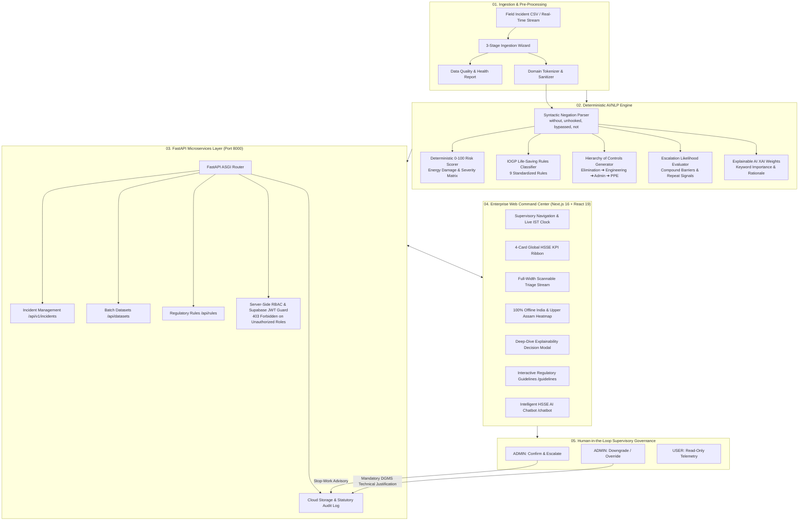

# OIL HSSE Enterprise SIF-Precursor Decision-Support Platform

<div align="center">


[](https://nextjs.org/)
[](https://react.dev/)
[](https://www.typescriptlang.org/)
[](https://tailwindcss.com/)
[](https://fastapi.tiangolo.com/)
[](https://python.org/)
[](https://supabase.com/)
[](https://vercel.com/)
[]()

**Smart India Hackathon (SIH) 2026** • **Problem Statement ID:** `SIH26165`  
**Client / Domain:** Oil India Limited (OIL) — Upstream E&P HSSE Directorate  
**Development Team:** `THΞ ΛRPΛNΞT`  
**Platform Version:** `v2.6.0` (Release Codename: `PR2`)

*An industrial-grade, explainable AI/NLP supervisory command layer engineered to detect Serious Injury & Fatality (SIF) precursors buried in high-volume unstructured safety narratives across upstream oil and gas installations.*

</div>

---

## 📑 Table of Contents

- [Executive Summary & Problem Statement](#-executive-summary--problem-statement)
- [System Architecture](#-system-architecture)
- [Key Platform Capabilities](#-key-platform-capabilities)
  - [1. Negation-Aware Industrial NLP & Risk Scoring](#1-negation-aware-industrial-nlp--risk-scoring)
  - [2. High-Density Supervisory Triage Stream](#2-high-density-supervisory-triage-stream)
  - [3. Deep-Dive Explainability Decision Modal (XAI)](#3-deep-dive-explainability-decision-modal-xai)
  - [4. 100% Offline Geospatial Asset Heatmap](#4-100-offline-geospatial-asset-heatmap)
  - [5. Intelligent HSSE AI Chatbot Assistant](#5-intelligent-hsse-ai-chatbot-assistant)
  - [6. 3-Stage Batch Ingestion & Dataset Lifecycle](#6-3-stage-batch-ingestion--dataset-lifecycle)
  - [7. Enterprise Two-Role RBAC & Unified Authentication](#7-enterprise-two-role-rbac--unified-authentication)
- [Technology Stack](#-technology-stack)
- [Repository Structure](#-repository-structure)
- [Quick Start & Local Setup](#-quick-start--local-setup)
- [Vercel Multi-Service Deployment Architecture](#-vercel-multi-service-deployment-architecture)
- [Verification & Automated Testing](#-verification--automated-testing)
- [Regulatory & Statutory Compliance](#-regulatory--statutory-compliance)
- [Hackathon Information & Team Credits](#-hackathon-information--team-credits)

---

## 📖 Executive Summary & Problem Statement

In upstream oil and gas exploration, drilling, workover, and crude transport operations across the Assam Basin and Northeast Frontier—including **Duliajan Rig #7, Moran Gas Gathering Station (GGS), Naharkatiya Well #114, Digboi Central Tank Farm, Kumchai Drilling, and offshore blocks**—field personnel log hundreds of Unsafe-Act (UA), Unsafe-Condition (UC), and Near-Miss (NM) event reports each week.

### The Operational Challenge: The SIF Paradox
In conventional upstream safety operations, **over 80% of reported events are minor, low-potential issues** (e.g., minor tool misplacement, small deck slips, minor PPE scuffs). However, buried within this voluminous stream are catastrophic, low-frequency **Serious Injury & Fatality (SIF) Precursors**:
- High-pressure reservoir gas kicks and blowouts
- Unisolated high-voltage electrical or mechanical energy (Lockout/Tagout bypass)
- Personnel positioned under suspended drill pipe tubulars or crane loads
- Toxic Hydrogen Sulfide ($H_2S$) atmospheric releases in confined cellars
- Primary barrier compromises on live high-pressure hydrocarbon flowlines

Because field observations are entered as unstructured natural language with regional vernacular and varied phrasing, naive keyword filters either generate overwhelming false alarms or miss critical hazards disguised by syntactic nuance (e.g., *"worker working at 12m height without safety harness"* vs *"safety harness inspected with zero tears found"*).

### The Solution: Human-in-the-Loop Supervisory Intelligence
The platform provides a **Human-in-the-Loop (HITL) Decision-Support Layer** that compresses triage time from hours to seconds while keeping certified human safety superintendents in absolute supervisory control:
1. **Contextual Negation NLP:** Evaluates syntactic clauses to detect genuine hazard triggers (`without`, `unhooked`, `failed to test`, `bypassed`) while avoiding false alarms from verified inspection logs (`tested with zero defects`).
2. **Deterministic 0–100 Risk Priority Scoring:** Computes transparent risk priority indices based on kinetic, chemical, electrical, and gravitational energy release models.
3. **IOGP Life-Saving Rules (LSR) Classification:** Automatically maps incidents to the 9 standardized IOGP safety rules.
4. **Hierarchy-of-Controls Prescriptions:** Automatically suggests ranked corrective actions across Elimination, Engineering, Administrative, and PPE tiers.
5. **Strict Two-Role Governance (`ADMIN` vs `USER`):** Enforces separation of duties with server-side `403 Forbidden` protection and statutory audit logging.

---

## 🏗️ System Architecture



---

## ⚡ Key Platform Capabilities

### 1. Negation-Aware Industrial NLP & Risk Scoring
- **Syntactic Negation Disambiguation:** Distinguishes genuine hazards (`"worker operated without safety harness"`, `"gas monitor not calibrated"`) from routine positive maintenance audits (`"inspected harness with no damage"`, `"gas tested with zero ppm H2S"`).
- **Deterministic 0–100 Risk Priority Score:** Standardized scoring based on energy categories:
  - **High-Pressure Gas / Wellbore Integrity** (Weight: 1.0)
  - **Suspended Mechanical Load / Line-of-Fire** (Weight: 0.95)
  - **Work at Height / Fall Protection** (Weight: 0.90)
  - **Confined Space / Toxic Atmosphere** (Weight: 0.90)
  - **Energy Isolation / LOTO** (Weight: 0.85)
- **Hierarchy of Controls Mapping:** Automatically attaches actionable mitigation steps:
  - 🛑 **Elimination / Substitution:** Depressurize wellhead, suspend line flow.
  - ⚙️ **Engineering Controls:** Interlocking gates, positive pressure ventilation.
  - 📋 **Administrative Controls:** PTW re-authorization, DGMS log entry, toolbox safety talk.
  - 🦺 **PPE Requirements:** Dual-lanyard fall arrest harness, positive-pressure SCBA.

### 2. High-Density Supervisory Triage Stream
- **Full-Width Scannable Layout:** Designed for 1080p, 1440p, and multi-monitor operations with zero horizontal scrolling.
- **Monospace Ordinal Indexing:** Dynamic index indicators (`01`, `02`, `03`...) reflect the active filtered queue state.
- **Inline Explainability Tokens:** Every card surfaces matched IOGP LSR violations, top trigger keywords with importance weights (e.g., `pressure kick (w: 0.94)`), and negation pills.
- **Dynamic Filtering & Real-Time Search:** Instant filtering by severity (`CRITICAL`, `HIGH`, `MEDIUM`, `LOW`), Life-Saving Rule, review status, and field installation.

### 3. Deep-Dive Explainability Decision Modal (XAI)
- **Accessible Viewport Portal:** Pinned header, internal scroll body, and pinned action footer with focus trap and keyboard dismissal (`Escape`).
- **Feature Importance Breakdown:** Normalized visual weight bars showing exact keyword contributions to the risk score.
- **Collapsed Verbatim Narrative:** Primary narrative starts collapsed by default to minimize cognitive clutter during high-tempo triage.
- **Role-Gated Actions:**
  - **`CONFIRM & ESCALATE`:** Issues stop-work order and alerts senior management.
  - **`DOWNGRADE / OVERRIDE`:** Requires mandatory technical written justification for DGMS/OISD statutory audit compliance.

### 4. 100% Offline Geospatial Asset Heatmap
- **Zero External Dependencies:** Built using bundled SVG TopoJSON/GeoJSON (`react-simple-maps`). Operates 100% offline in isolated operational air-gapped field networks without Google Maps or Mapbox API keys.
- **Upper Assam Asset Telemetry:** Accurate coordinate mapping for **Duliajan, Moran, Naharkatiya, Digboi, Kumchai, Borbil, Dikom, and Shalmari**.
- **Proportional Risk Bubbles:** Circle area scaled by incident count ($r \propto \sqrt{N}$), filled with worst-severity token color (`CRITICAL` = `#EF4444`, `HIGH` = `#F97316`), contrasting 1.5px stroke, and critical cluster pulse rings.
- **Interactive Controls:** Smooth pan & zoom (`0.8x` to `4.0x`), "Fit to data" auto-bounding, and linked risk-ranked site list.

### 5. Intelligent HSSE AI Chatbot Assistant (`/chatbot`)
- **Domain Regulatory Knowledge Base:** Grounded in OISD standards, DGMS Oil Mines Regulations (OMR 2017), and IOGP Life-Saving Rules.
- **Interactive Decision-Support:** Field operators and safety officers can query risk mitigation procedures, standard operating limits, and emergency protocols in natural language.
- **Quick-Prompt Suggestions:** One-click shortcuts for high-pressure gas kicks, $H_2S$ exposure limits, crane lift clearances, and hot-work permits.

### 6. 3-Stage Batch Ingestion & Dataset Lifecycle
- **Stage 1 — Upload Dropzone:** Drag-and-drop CSV ingestion with client-side chunked parsing (`PapaParse`) and a 1-click sample dataset loader.
- **Stage 2 — Data Quality Health Report:** Pre-ingestion validation showing total rows, valid records, duplicate entries, malformed dates, and an expandable data preview grid.
- **Stage 3 — Sequential Processing Pipeline:** Atomic staged animation indicating progress (Uploading → Validating → Cleaning → Normalizing → Analyzing → Storing).
- **Cascade Deletion with Audit Archival:** Deleting a dataset cleanly purges all associated incidents while permanently logging the action in `audit_logs` for compliance.

### 7. Enterprise Two-Role RBAC & Unified Authentication
- **Two-Role Model:**
  - **`ADMIN`:** Full supervisory authority (Confirm SIF, Downgrade/Override, Dataset Ingestion/Deletion, Admin Settings).
  - **`USER`:** Read-only stakeholder access (Dashboard, Triage stream, Analytics, Geospatial Map). Action buttons are omitted from the UI and protected on the backend.
- **Unified Single Form:** Shared fields (`email`, `password`) never unmount during Sign-in ↔ Create-account transitions, preserving typed input across tab switches.
- **Smooth Height Transition:** Extra fields (`Full name`, `Confirm password`, policy notice) animate with `grid-template-rows: 0fr -> 1fr` and opacity over 260ms `cubic-bezier(0.22, 1, 0.36, 1)`.
- **Top-Anchored Card Layout:** Card is anchored to the top of the viewport area, ensuring only the bottom edge moves during height changes with zero vertical page jump.
- **Specific Error Code Mapping:** Error banners display precise, user-friendly messages with technical reference lines (e.g., `Reference: invalid_credentials`, `Reference: email_not_confirmed`).
- **Resend Confirmation Cooldown:** 60-second countdown timer for unconfirmed email accounts.

---

## 💻 Technology Stack

| Layer | Technology | Version | Purpose |
|---|---|---|---|
| **Frontend Framework** | Next.js (App Router) | `16.3.4` | Server-rendered & client-hydrated supervisory console |
| **Core UI Library** | React | `19.2.8` | Component lifecycle, modern concurrency, and state |
| **Language** | TypeScript | `5.x` | End-to-end type safety for incident payloads and domain state |
| **Styling** | Tailwind CSS | `v4.0` | High-density dark industrial design system |
| **Motion & Micro-interactions**| GSAP + Motion React | `3.15.0` / `14.4.0` | Timed transitions under 500ms; reduced-motion compliant |
| **Iconography** | Lucide React | `1.43.0` | 100% SVG icon design system (Zero emojis in UI) |
| **Geospatial Mapping** | react-simple-maps | `5.0.5` | 100% offline SVG India and Assam field incident mapping |
| **Data Visualization** | Recharts | `3.10.1` | Incident trend charts, severity ratios, and analytics |
| **Backend Framework** | FastAPI | `0.115+` | High-performance asynchronous REST microservices |
| **ASGI Server** | Uvicorn | `0.30+` | Lightning-fast asynchronous web server runtime |
| **Data Validation** | Pydantic | `v2.8+` | Strict schema validation for all incoming and outgoing payloads |
| **Database & Auth** | Supabase (PostgreSQL) | `2.116.0` | Managed PostgreSQL with Row-Level Security (RLS) & Auth JWTs |
| **Deployment Engine** | Vercel Multi-Service | Monorepo | Unified deployment routing frontend and backend under one project |
| **Test Suite** | Pytest | `8.x` | Automated backend testing for NLP logic, RBAC, and APIs |

---

## 📁 Repository Structure

```
OIL-HSSE/
├── backend/                              # FastAPI Backend Microservices
│   ├── app/
│   │   ├── main.py                       # FastAPI application entrypoint & middleware
│   │   ├── config.py                     # Environment configuration & Supabase settings
│   │   ├── logic_engine/                 # Deterministic NLP, LSR, Negation & Escalation rules
│   │   │   ├── escalation_evaluator.py   # 0-100 multi-factor escalation likelihood engine
│   │   │   ├── rules_data.py             # 9 IOGP rules, keyword groups, and control sets
│   │   │   └── rules_engine.py           # Core text parsing, scoring, and XAI weights
│   │   ├── routers/                      # REST API endpoint routes
│   │   │   ├── auth.py                   # Role profile sessions (ADMIN vs USER)
│   │   │   ├── datasets.py               # Dataset batch management & cascade deletion
│   │   │   ├── incidents.py              # Incident queue, predict, confirm, and override
│   │   │   └── rules.py                  # Live /api/rules endpoint for Guidelines tab
│   │   ├── services/                     # Persistence & Supabase data abstraction
│   │   └── data/local_storage.json       # File-backed local disk storage fallback
│   ├── tests/
│   │   ├── test_api.py                   # Pytest test suite (API endpoints & RBAC)
│   │   ├── test_logic_engine.py          # Unit tests for NLP parser & risk calculations
│   │   └── test_upload_persistence.py    # Ingestion & storage persistence tests
│   ├── requirements.txt                  # Python dependencies
│   └── run.py                            # Local Uvicorn server launcher
│
├── database/                             # Database Schema & Seed Assets
│   ├── schema/schema.sql                 # PostgreSQL / Supabase schema (RLS, FKs, Check constraints)
│   └── seed/seed.sql                     # Verified E&P asset test fixtures
│
├── oil-hsse-app/                         # Next.js 16 Web Command Center
│   ├── src/
│   │   ├── app/                          # Next.js App Router routes
│   │   │   ├── layout.tsx                # Master enterprise layout & metadata
│   │   │   ├── page.tsx                  # Root redirect & dashboard shell
│   │   │   ├── dashboard/                # Main Supervisory Command Center
│   │   │   ├── analytics/                # HSSE operational safety analytics
│   │   │   ├── chatbot/                  # Intelligent HSSE AI Chatbot Assistant
│   │   │   ├── datasets/                 # Batch dataset governance & cascade deletion
│   │   │   ├── guidelines/               # Accordion-based IOGP LSR & Hierarchy reference
│   │   │   └── login/                    # Unified authentication portal (ADMIN / USER)
│   │   ├── components/                   # UI components
│   │   │   ├── Navigation.tsx            # Header, basin context, live clock, 12h/24h toggle
│   │   │   ├── KpiRibbon.tsx             # 4-card operational KPI summary
│   │   │   ├── TriageStream.tsx          # Full-width scannable incident queue with inline XAI
│   │   │   ├── ExplainabilityConsole.tsx # Deep-dive decision modal with role gating
│   │   │   ├── IndiaIncidentMap.tsx      # 100% offline Upper Assam SVG incident heatmap
│   │   │   ├── IngestionModal.tsx        # 3-stage batch CSV upload & health report wizard
│   │   │   ├── EscalationLikelihoodGauge.tsx # Heuristic escalation indicator
│   │   │   └── ui/                       # IconMap, EmptyState, Badge, and primitives
│   │   ├── context/                      # React Context providers (Safety, Auth, TimeFormat)
│   │   ├── hooks/                        # GSAP motion and responsive layout hooks
│   │   ├── lib/                          # API client, CSV pipeline, normalizer, logic engine
│   │   ├── config/version.ts             # Single source of truth for version (v2.6.0 · PR2)
│   │   └── data/                         # Bundled India GeoJSON & E&P mock incident baselines
│   └── package.json                      # Frontend dependencies & npm scripts
│
├── rest/
│   └── API_CONTRACT.md                   # Formal REST API Contract Specification
├── vercel.json                           # Vercel Multi-Service Project Configuration
├── PROGRESS.md                           # Master Progress Record & Sprint Changelog
├── description.md                        # Technical System Description
└── README.md                             # This file
```

---

## 🚀 Quick Start & Local Setup

### Prerequisites
- **Node.js:** `v18.18.0` or higher (`v20+` LTS recommended)
- **Python:** `3.11` or higher
- **Package Manager:** `npm` or `pnpm`

### 1. Backend Setup (FastAPI Microservices)

```bash
# 1. Navigate to the backend directory
cd backend

# 2. Create and activate a Python virtual environment
python3 -m venv .venv
source .venv/bin/activate       # On Windows: .venv\Scripts\activate

# 3. Install dependencies
pip install -r requirements.txt

# 4. Start the backend API server (runs on port 8000)
python run.py
# Or directly via Uvicorn:
# uvicorn app.main:app --host 0.0.0.0 --port 8000 --reload
```
> The API will be active at `http://localhost:8000`.  
> Interactive OpenAPI documentation is available at `http://localhost:8000/docs` and `http://localhost:8000/redoc`.

### 2. Frontend Setup (Next.js Command Center)

```bash
# 1. Open a new terminal and navigate to the frontend directory
cd oil-hsse-app

# 2. Install dependencies
npm install

# 3. Start the local development server (runs on port 3000)
npm run dev

# 4. Verify production build
npm run build
```
> Open your browser and navigate to **`http://localhost:3000`**.

### 3. Role-Based Access Credentials
The platform implements strict two-role authentication on the `/login` screen:
- **`ADMIN` (Safety Superintendent / HSSE Lead):** Full supervisory authority to confirm SIF precursors, initiate stop-work orders, override flags with regulatory rationale, upload datasets, and delete batches.
- **`USER` (Field Safety Observer / Stakeholder):** Read-only visibility across dashboards, analytics, and incident queues. Action buttons and decision controls are cleanly omitted.

---

## 🌐 Vercel Multi-Service Deployment Architecture

The repository is configured for **Vercel Multi-Service Deployment** via `vercel.json`. This enables deploying both the FastAPI Python backend and the Next.js frontend together as a single project with unified routing:

```json
{
  "$schema": "https://openapi.vercel.sh/vercel.json",
  "services": {
    "oil-hsse-app": {
      "root": "oil-hsse-app",
      "framework": "nextjs",
      "bindings": [
        {
          "type": "service",
          "service": "backend",
          "format": "url",
          "env": "BACKEND_URL"
        }
      ]
    },
    "backend": {
      "root": "backend",
      "framework": "fastapi",
      "entrypoint": "main:app"
    }
  },
  "rewrites": [
    {
      "source": "/api/(.*)",
      "destination": {
        "service": "backend"
      }
    },
    {
      "source": "/docs",
      "destination": {
        "service": "backend"
      }
    },
    {
      "source": "/redoc",
      "destination": {
        "service": "backend"
      }
    },
    {
      "source": "/openapi.json",
      "destination": {
        "service": "backend"
      }
    },
    {
      "source": "/(.*)",
      "destination": {
        "service": "oil-hsse-app"
      }
    }
  ]
}
```

---

## 🧪 Verification & Automated Testing

The backend includes a comprehensive **pytest** regression suite covering REST endpoints, NLP edge cases, negation parsing, server-side RBAC, and cascade deletions:

```bash
cd backend
source .venv/bin/activate
PYTHONPATH=. pytest tests/test_api.py tests/test_logic_engine.py -v
```

### Key Test Coverage Highlights:
- ✅ **NLP & Negation Logic:** Validates that *"without safety harness"* scores $\ge 85$ (Critical) while *"safety harness inspected with zero tears"* scores $\le 30$ (Low).
- ✅ **Server-Side RBAC Enforcement:** Verifies that calling `POST /api/v1/incidents/{id}/confirm` or `/override` with `X-User-Role: USER` returns `403 Forbidden`.
- ✅ **Cascade Dataset Deletion:** Verifies that deleting a dataset purges all associated incidents from the queue while preserving an immutable record in `audit_logs`.
- ✅ **Dynamic Rules Endpoint:** Tests that `GET /api/rules` serves all 9 IOGP rules and 4-tier hierarchy definitions directly from the logic engine.
- ✅ **Escalation Heuristic:** Validates deterministic calculation of escalation tiers across high-energy and repeat incident fixtures.

---

## 📜 Regulatory & Statutory Compliance

The platform is engineered in strict alignment with Indian statutory mandates and international upstream petroleum standards:

- **OISD (Oil Industry Safety Directorate):**
  - **OISD-STD-105:** Work Permit System for exploration, drilling, and production installations.
  - **OISD-GDN-114:** Safe Handling of Hazardous Chemicals and Gases ($H_2S$, condensates).
  - **OISD-STD-156:** Fire Protection and Control in Oil & Gas Installations.
- **DGMS (Directorate General of Mines Safety):**
  - **Oil Mines Regulations (OMR) 2017:** Mandatory statutory incident recording, stop-work directives, and technical override justification audit logging.
- **IOGP (International Association of Oil & Gas Producers):**
  - **Report 459:** Standardized 9 Life-Saving Rules (LSR).
  - **Report 590:** Serious Injury and Fatality (SIF) Precursor Identification and Prevention Methodology.
- **OSHA 29 CFR 1910.119:** Process Safety Management (PSM) of Highly Hazardous Chemicals.

---

## 👥 Hackathon Information & Team Credits

- **Smart India Hackathon (SIH) 2026**
- **Problem Statement ID:** `SIH26165`
- **Problem Statement Title:** *AI/NLP Engine to Detect Serious Injury & Fatality (SIF) Precursors in OIL's Unsafe-Act / Unsafe-Condition and Near-Miss Reports*
- **Client Organization:** Oil India Limited (OIL) — Upstream E&P HSSE Directorate
- **Team Name:** `THΞ ΛRPΛNΞT`
- **Current Version:** `v2.6.0` (Release Codename: `PR2`)
