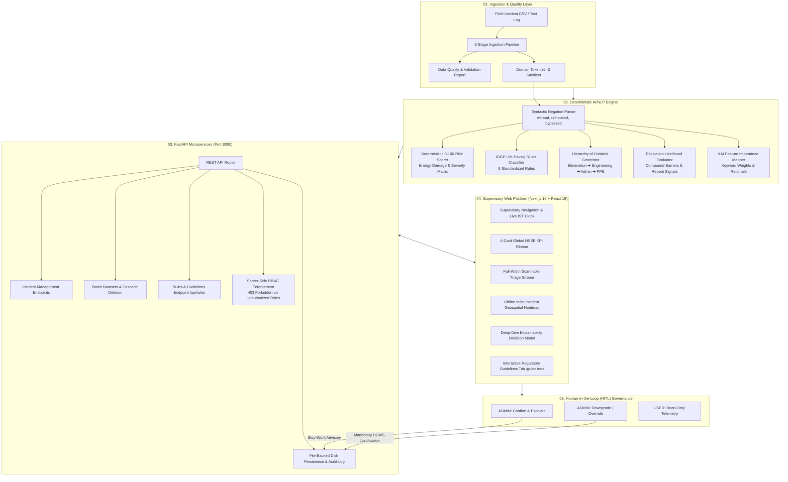

# OIL HSSE Enterprise SIF-Precursor Decision-Support Platform

<div align="center">


[](https://nextjs.org/)
[](https://react.dev/)
[](https://www.typescriptlang.org/)
[](https://tailwindcss.com/)
[](https://fastapi.tiangolo.com/)
[](https://python.org/)
[](https://docs.pytest.org/)
[]()

**Smart India Hackathon (SIH) 2026** • **Problem Statement ID:** `SIH26165`  
**Client / Domain:** Oil India Limited (OIL) — Upstream E&P HSSE Directorate  
**Team:** `THΞ ΛRPΛNΞT`  

*An industrial-grade, explainable AI/NLP supervisory command layer engineered to detect Serious Injury & Fatality (SIF) precursors buried in high-volume unstructured safety narratives across upstream oil and gas assets.*

</div>

---

## 📖 Product Overview

The **OIL HSSE Enterprise SIF-Precursor Decision-Support Platform** is an industrial safety supervisory system purpose-built for the upstream Exploration & Production (E&P) operations of **Oil India Limited (OIL)**. 

Across high-tempo operational theaters in the Assam Basin and Northeast frontier—including **Duliajan Rig #7, Moran Gas Gathering Station (GGS), Naharkatiya Well #114, Digboi Central Tank Farm, Kumchai Drilling, and offshore blocks**—field crews log hundreds of Unsafe-Act (UA), Unsafe-Condition (UC), and Near-Miss (NM) event reports every week.

### The Operational Challenge: The SIF Paradox & Narrative Blind Spots
In traditional upstream operations, **over 80% of reported incidents are low-potential events**, such as slipping on oily deck plates, minor tool misplacements, or PPE scuffs. However, buried within this high-volume stream are rare, catastrophic **Serious Injury & Fatality (SIF) Precursors**:
- High-pressure gas kicks and uncontrolled well surges
- Bypassed Lockout/Tagout (LOTO) and unisolated electrical/mechanical energy
- Workers positioned beneath suspended tubulars and crane loads
- Toxic Hydrogen Sulfide ($H_2S$) releases and confined space atmospheric hazards
- Compromised primary barriers on high-pressure crude flowlines

Because field observations are documented in colloquial, hurried, and unstructured natural language, standard keyword filters either **drown safety superintendents in false alarms** or **completely miss critical hazards** masked by complex syntactic phrasing (e.g., *"worker working at 12m height without secondary lanyard attached"* vs *"safety harness inspected with zero tears found"*).

### The Solution: A Human-in-the-Loop Supervisory Command Center
The platform does **not** attempt to replace certified human safety officers with a black-box model. Instead, it serves as an **industrial decision-support layer** that reduces time-to-escalation from hours to seconds:
1. **Ingests & Normalizes** unstructured field reports across batch CSV uploads and real-time incident streams.
2. **Performs Syntactic Negation-Aware NLP** to isolate high-energy hazard triggers while preserving critical safety negations.
3. **Computes Deterministic 0–100 Risk Priority Scores** mapped directly to IOGP Life-Saving Rules and energy damage classifications.
4. **Evaluates Escalation Likelihood** through a multi-factor deterministic heuristic (recurring site hazards, high-energy modifiers, compounding barrier negations).
5. **Provides Explainable AI (XAI)** with explicit feature importance weights, raw narrative breakdown, and prescriptive Hierarchy-of-Controls remedies.
6. **Enforces Strict Two-Role Governance (`ADMIN` vs `USER`)** backed by server-side authorization (`403 Forbidden` defense-in-depth) and immutable OISD/DGMS statutory audit logs.

---

## ⚡ Key Platform Capabilities

```
┌──────────────────────────────────────────────────────────────────────────────────────────┐
│                             OIL HSSE COMMAND CENTER (v2.2.1 · SNOW)                      │
├────────────────────────────┬────────────────────────────┬────────────────────────────────┤
│  🎯 Negation-Aware NLP     │  📊 Deterministic Risk     │  🛡️ Human-in-the-Loop          │
│  Preserves "without",      │  0–100 scoring based on    │  ADMIN-gated stop-work         │
│  "unhooked", "bypassed" to │  high-energy categories &  │  escalation with mandatory     │
│  prevent false safety flags│  IOGP Life-Saving Rules    │  technical justification logs  │
├────────────────────────────┼────────────────────────────┼────────────────────────────────┤
│  🗺️ 100% Offline Geo-Map   │  ⏱️ Multi-Monitor Stream   │  📋 Dynamic Guidelines        │
│  Bundled Upper Assam SVG   │  Full-width triage queue   │  Live-synced 9 IOGP LSR        │
│  heatmap with zoom/pan and │  with monospace indexing   │  remediations and 4-tier       │
│  real-time asset telemetry │  and inline XAI badges     │  Hierarchy of Controls         │
└────────────────────────────┴────────────────────────────┴────────────────────────────────┘
```

### 1. Negation-Aware Domain NLP & Risk Scoring
- **Contextual Negation Parser:** Accurately distinguishes genuine safety breaches (`without harness`, `failed to test gas`, `bypassed LOTO`, `not depressurized`) from mitigated or benign safety audits (`harness inspected with zero defects`, `gas tested with no hazardous readings`).
- **IOGP Life-Saving Rules (LSR) Classification:** Classifies events into the 9 standardized IOGP rules (Bypassing Safety Controls, Confined Space, Energy Isolation, Hot Work, Line of Fire, Safe Mechanical Lifting, Work Authorization, Working at Height, Driving).
- **Hierarchy-of-Controls Generator:** Instantly suggests prioritized operational controls categorized across:
  - 🛑 **Elimination / Substitution** (e.g., depressurize flowline, isolate wellhead power)
  - ⚙️ **Engineering Controls** (e.g., install double block & bleed, physical interlocking barriers)
  - 📋 **Administrative Controls** (e.g., PTW re-validation, toolbox talk, DGMS log entry)
  - 🦺 **PPE** (e.g., dual-lanyard full-body harness, 4-gas monitor, positive-pressure SCBA)

### 2. Deterministic Escalation Likelihood Heuristic
- Computes an honest, explainable escalation risk tier (**LOW**, **MODERATE**, **HIGH**, **SEVERE**) based on:
  - Density of high-energy hazard modifiers present in the narrative
  - Historical site/LSR recurring hazard patterns across asset clusters
  - Review latency on unvalidated critical incidents
  - Compounding barrier negation clauses

### 3. High-Density Supervisory Triage Stream
- **Full-Width Scannable Event Queue:** Designed for 1080p, 1440p, and multi-monitor operations with zero awkward horizontal scrolling.
- **Monospace Ordinal Indexing:** Dynamic index markers (`01`, `02`, `03`...) reflect the active filtered queue order.
- **Inline Explainability Banner:** Every incident card displays matched LSR violations, top trigger keywords with importance weights (e.g., `pressure kick (w: 0.94)`), and negation indicator badges.
- **Accessible Decision Modal:** Deep-dive modal with collapsed-by-default raw narrative to reduce visual clutter, complete feature weights, and role-gated decision actions.

### 4. Enterprise Role-Based Access Control (RBAC) & Governance
- **Strict Two-Role Model:**
  - **`ADMIN`:** Supervisory safety authority. Can execute `CONFIRM & ESCALATE` (issues stop-work advisories), perform `DOWNGRADE / OVERRIDE` (requires written technical justification for DGMS/OISD compliance), upload datasets, and delete batches.
  - **`USER`:** Read-only stakeholder access. Action buttons are completely omitted from the UI to avoid confusion.
- **Server-Side Authorization:** Client-side UI omission is backed by FastAPI server-side verification. Non-admin mutating requests are rejected with `403 Forbidden`.
- **Statutory Audit Trail:** Immutable audit logging for every decision override and batch dataset cascade deletion.

### 5. 100% Offline Geospatial Asset Heatmap
- Bundled offline SVG map of India and Upper Assam E&P assets (`react-simple-maps` with local TopoJSON/GeoJSON; zero external tile or API calls).
- Interactive installation coordinate lookups for **Duliajan, Moran, Naharkatiya, Digboi, Kumchai, Borbil, Dikom, and Shalmari**.
- Smooth pan and zoom controls (`0.8x` to `4.0x`), cluster pulse indicators, and live telemetry callouts.

### 6. 3-Stage Batch Ingestion & Dataset Lifecycle
- **Progressive Upload Wizard:**
  1. *Dropzone Stage:* Drag-and-drop CSV upload with a 1-click sample dataset loader.
  2. *Quality Health Report:* Pre-ingestion validation detailing row counts, valid records, duplicates, invalid dates, and an expandable data preview table.
  3. *Sequential Processing Pipeline:* Atomic stage-by-stage pipeline animation (Uploading → Validating → Cleaning → Normalizing → Analyzing → Storing).
- **Cascade Deletion with Audit Retention:** Deleting a dataset cleanly purges all derived incidents from disk and state while permanently archiving an immutable record in `audit_logs`.

### 7. Restrained Enterprise Motion & Design System
- Built to the official Oil India Limited industrial palette: Deep Obsidian (`#090D16`), Surface Dark (`#0E1424`), Muted Slate (`#1E293B`), and OIL Industrial Gold (`#D4AF37`).
- Zero raw emoji characters in rendered UI; standardized using `lucide-react` SVG icon mapping.
- Lightweight 2D canvas ambient inference network with graceful degradation for mobile and full support for `prefers-reduced-motion`.
- All UI transitions powered by GSAP timelines kept strictly under 500ms.

---

## 🏗️ System Architecture



---

## 💻 Technology Stack

| Layer | Technology | Version | Purpose |
|---|---|---|---|
| **Frontend Framework** | Next.js (App Router) | `16.3.4` | Server-rendered and client-hydrated enterprise application |
| **Core UI Library** | React | `19.2.8` | Component lifecycle, state management, and modern concurrency |
| **Language** | TypeScript | `5.x` | Strict type safety across all safety domains, payloads, and state |
| **Styling** | Tailwind CSS | `v4.0` | High-density dark industrial design system |
| **Motion & Dynamics** | GSAP + Canvas 2D | `3.15.0` | Micro-interactions under 500ms and ambient network visualization |
| **Iconography** | Lucide React | `1.43.0` | Centralized SVG icon mapping (100% emoji-free UI) |
| **Geospatial Mapping** | react-simple-maps | `5.0.5` | 100% offline SVG India and Assam field incident mapping |
| **Backend Framework** | FastAPI | `0.110+` | High-performance asynchronous REST microservices |
| **Server Runtime** | Python / Uvicorn | `3.11+` | Asynchronous ASGI execution engine |
| **Test Suite** | Pytest | `8.x` | Automated backend testing (**43/43 tests passing**) |
| **Database & Persistence** | PostgreSQL / Supabase | Schema v2.1 | Relational safety schema with file-backed local persistence fallback |
| **CSV Parsing** | PapaParse | `5.7.0` | Client-side chunked batch incident ingestion and sanitization |

---

## 📁 Repository Structure

```
SIH 26/
├── backend/                              # FastAPI Backend Microservices
│   ├── app/
│   │   ├── main.py                       # FastAPI application entrypoint & middleware
│   │   ├── logic_engine/                 # Deterministic NLP, LSR, Negation & Escalation rules
│   │   │   ├── escalation_evaluator.py   # 0-100 multi-factor escalation likelihood engine
│   │   │   ├── rules_data.py             # 9 IOGP rules, keyword groups, and control sets
│   │   │   └── rules_engine.py           # Core text parsing, scoring, and XAI weights
│   │   ├── routers/                      # REST API endpoint definitions
│   │   │   ├── auth.py                   # Role profile sessions (ADMIN vs USER)
│   │   │   ├── datasets.py               # Dataset batch management & cascade deletion
│   │   │   ├── incidents.py              # Incident queue, predict, confirm, and override
│   │   │   └── rules.py                  # Live /api/rules endpoint for Guidelines tab
│   │   ├── services/                     # Persistence & Supabase data abstraction
│   │   └── data/local_storage.json       # File-backed local disk storage
│   ├── tests/
│   │   └── test_api.py                   # Pytest test suite (43/43 automated tests)
│   ├── requirements.txt                  # Python backend dependencies
│   └── run.py                            # Uvicorn backend launcher
│
├── database/                             # Database Schema & Seed Assets
│   ├── schema/schema.sql                 # PostgreSQL / Supabase schema (RLS, FKs, Check constraints)
│   └── seed/seed.sql                     # Verified E&P asset test fixtures
│
├── oil-hsse-app/                         # Next.js 16 Web Command Center
│   ├── src/
│   │   ├── app/                          # Next.js App Router routes
│   │   │   ├── layout.tsx                # Master enterprise layout & metadata
│   │   │   ├── page.tsx                  # Root redirect & dashboard shell
│   │   │   ├── dashboard/                # Main Supervisory Command Center
│   │   │   ├── analytics/                # HSSE operational safety analytics
│   │   │   ├── datasets/                 # Batch dataset governance & cascade deletion
│   │   │   ├── guidelines/               # Accordion-based IOGP LSR & Hierarchy reference
│   │   │   └── login/                    # Two-role authentication portal (ADMIN / USER)
│   │   ├── components/                   # UI components
│   │   │   ├── Navigation.tsx            # Header, basin context, live clock, 12h/24h toggle
│   │   │   ├── KpiRibbon.tsx             # 4-card operational KPI summary
│   │   │   ├── TriageStream.tsx          # Full-width scannable incident queue with inline XAI
│   │   │   ├── ExplainabilityConsole.tsx # Deep-dive decision modal with role gating
│   │   │   ├── IndiaIncidentMap.tsx      # 100% offline Upper Assam SVG incident heatmap
│   │   │   ├── IngestionModal.tsx        # 3-stage batch CSV upload & health report wizard
│   │   │   ├── EscalationLikelihoodGauge.tsx # Heuristic escalation indicator
│   │   │   └── ui/                       # IconMap, EmptyState, Badge, and primitives
│   │   ├── context/                      # React Context providers (Safety, Auth, TimeFormat)
│   │   ├── hooks/                        # GSAP motion and responsive layout hooks
│   │   ├── lib/                          # API client, CSV pipeline, normalizer, logic engine
│   │   ├── config/version.ts             # Single source of truth for version (v2.2.1 · SNOW)
│   │   └── data/                         # Bundled India GeoJSON & E&P mock incident baselines
│   └── package.json                      # Frontend dependencies & npm scripts
│
├── rest/
│   └── API_CONTRACT.md                   # Formal REST API Contract Specification
├── PROGRESS.md                           # Master Progress Record & Sprint Changelog
├── description.md                        # Technical System Description
└── README.md                             # This file
```

---

## 🚀 Quick Start Guide

### Prerequisites
- **Node.js:** `v18.18.0` or higher (`v20+` LTS recommended)
- **Python:** `3.11` or higher
- **Package Manager:** `npm` or `pnpm`

### 1. Backend Setup (FastAPI Microservices)

```bash
# 1. Navigate to backend directory
cd backend

# 2. Create and activate virtual environment
python3 -m venv .venv
source .venv/bin/activate       # On Windows: .venv\Scripts\activate

# 3. Install dependencies
pip install -r requirements.txt

# 4. Run automated test suite (verifies 43/43 tests passing)
PYTHONPATH=. pytest tests/test_api.py -v

# 5. Start the backend API server (runs on port 8000)
python run.py
# Alternatively: uvicorn app.main:app --host 0.0.0.0 --port 8000 --reload
```
> The API will be active at `http://localhost:8000`. Interactive OpenAPI documentation is available at `http://localhost:8000/docs`.

### 2. Frontend Setup (Next.js Command Center)

```bash
# 1. Open a new terminal and navigate to frontend directory
cd oil-hsse-app

# 2. Install dependencies
npm install

# 3. Start local development server (runs on port 3000)
npm run dev

# 4. Verify production build
npm run build
```
> Open your browser and navigate to **`http://localhost:3000`**.

### 3. Role-Based Login Credentials (Pre-Configured)
The platform enforces two distinct roles on the `/login` screen:
- **`ADMIN` (Safety Superintendent / HSSE Lead):** Full supervisory authority to confirm SIF precursors, initiate stop-work orders, override flags with regulatory rationale, upload datasets, and manage batches.
- **`USER` (Field Safety Observer / Stakeholder):** Read-only visibility across dashboards, analytics, and incident queues. Action buttons and decision controls are cleanly omitted.

---

## 🧪 Verification & Automated Testing

The backend includes a comprehensive **pytest** regression suite covering REST endpoints, NLP edge cases, negation parsing, server-side RBAC, and cascade deletions:

```bash
cd backend
source .venv/bin/activate
PYTHONPATH=. pytest tests/test_api.py -v
```

### Key Test Coverage Highlights:
- ✅ **NLP & Negation Logic:** Validates that *"without safety harness"* scores $\ge 85$ (Critical) while *"safety harness inspected with zero tears"* scores $\le 30$ (Low).
- ✅ **Server-Side RBAC Enforcement:** Verifies that calling `POST /api/v1/incidents/{id}/confirm` or `/override` with `X-User-Role: USER` returns `403 Forbidden`.
- ✅ **Cascade Dataset Deletion:** Verifies that deleting a dataset purges all associated incidents from the queue while preserving an immutable record in `audit_logs`.
- ✅ **Dynamic Rules Endpoint:** Tests that `GET /api/rules` serves all 9 IOGP rules and 4-tier hierarchy definitions directly from the logic engine.
- ✅ **Escalation Heuristic:** Validates deterministic calculation of escalation tiers across high-energy and repeat incident fixtures.

---

## 📜 Regulatory & HSSE Standard Compliance

The platform is engineered in strict alignment with Indian statutory mandates and international upstream petroleum standards:

- **OISD (Oil Industry Safety Directorate):**
  - **OISD-STD-105:** Work Permit System for exploration, drilling, and production installations.
  - **OISD-GDN-114:** Safe Handling of Hazardous Chemicals and Gases ($H_2S$, condensates).
  - **OISD-STD-156:** Fire Protection and Control in Oil & Gas Installations.
- **DGMS (Directorate General of Mines Safety):**
  - **Oil Mines Regulations (OMR) 2017:** Mandatory statutory incident recording, stop-work directives, and technical override justification audit logging.
- **IOGP (International Association of Oil & Gas Producers):**
  - **Report 459:** Standardized 9 Life-Saving Rules (LSR).
  - **Report 590:** Serious Injury and Fatality (SIF) Precursor Identification and Prevention Methodology.
- **OSHA 29 CFR 1910.119:** Process Safety Management (PSM) of Highly Hazardous Chemicals.

---

## 👥 Hackathon Information & Credits

- **Smart India Hackathon (SIH) 2026**
- **Problem Statement ID:** `SIH26165`
- **Problem Statement Title:** *AI/NLP Engine to Detect Serious Injury & Fatality (SIF) Precursors in OIL's Unsafe-Act/Unsafe-Condition and Near-Miss Reports*
- **Client Organization:** Oil India Limited (OIL) — Upstream E&P HSSE Directorate
- **Team Name:** `THΞ ΛRPΛNΞT`
- **Platform Display Version:** `v2.2.1 · SNOW` (Platform v2.5.0 Master Release)
